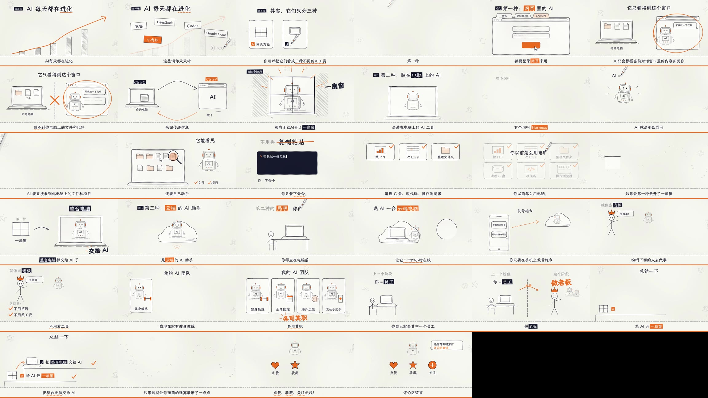

# explainer-video

**一个把「话题 / 开源项目 / 知识点」做成中文科普短视频的 Agent Skill** —— 口播、逐字字幕、配乐、音效、混音母版、质检评分表、各平台文案，一次交付。

[English](README.md) · [简体中文](README.zh-CN.md) · [文档站](https://bobobo2026.github.io/explainer-video/zh.html) · [llms.txt](https://bobobo2026.github.io/explainer-video/llms.txt)

[](LICENSE)
[](SKILL.md)
[](https://bobobo2026.github.io/explainer-video/zh.html)


---

## explainer-video 是什么？

`explainer-video` 是一个可复用的 **Agent Skill**：一个文件夹，里面是 `SKILL.md` 入口 + 一套共用制作流程 + 可直接运行的 Python/Shell 脚本 + 两种画风的完整渲染引擎。把整个文件夹复制进 Agent 的 skills 目录，它就能从选题研究一路做到成片 MP4 和各平台文案（抖音 / 小红书 / B站 / 视频号 / X）。

它**不是**文生视频模型。画面是真实代码（React/Remotion 合成、Canvas 白板场景），由逐字时间轴驱动，所以每一帧都是确定、可改、可重渲的 —— 换一版配音，动画、音效、字幕会自动重新对齐。

- **两种画风，一套流程**：手绘白板（16:9）与拟真出镜竖屏（1080×1920）。
- **逐字时间轴是骨架**：一份 `timeline.json`（`{scene, say, start, end, words[], mouth}`）同时驱动字幕、动画卡点、音效和口型。
- **为 Agent 设计**：整体拷进 skills 目录即可用；不需要服务、不需要 API key（除非你要用付费 TTS）。

## 两种画风

| | 手绘笔记 `styles/handdrawn/` | 拟真出镜 `styles/realistic/` |
|---|---|---|
| 样子 | 白纸、钢笔线、马克笔，边说边画 | 出镜主播（口型同步）+ 真实截图 + 手绘圈注 + 手持微晃 + 胶片颗粒 |
| 适合 | 抽象概念、方法论、「X 是什么」 | 热点项目、产品/工具介绍、带数据的新闻 |
| 画幅 | 1920×1080（含竖屏补丁） | **1080×1920 原生竖屏** |
| 引擎 | [dashi-animationstyle](https://github.com/chuspeeism/dashi-animationstyle)（Canvas） | [Remotion](https://github.com/remotion-dev/remotion)（React），模板可直接渲染 |

| 拟真竖屏 · 参考成片联系表（REA 那期） |
|---|
|  |

| 手绘白板 · 参考成片联系表 |
|---|
|  |

## 关键事实

| | |
|---|---|
| Skill 版本 | v3（合并为一个 skill，两种画风） |
| 竖屏模板可复用场景 | 13 个（`hook` → `cta`） |
| 附带参考帧 | 拟真 16 张 + 手绘 19 张 |
| 目标片长 | 60–120 秒 |
| 真人录音字级对齐 | 匹配率约 95%，中位误差约 0.04 秒（faster-whisper 词级） |
| 母版响度 | 集成 −14 LUFS，真峰 −1.5 dBTP，音乐给人声让路 |
| 配乐 | `pluck96`（现代拨弦）/ `lofi84`（温柔 lofi）两种 |
| 渲染耗时 | 约 3.7 秒墙钟 / 1 秒视频（Remotion，并发 2） |
| 交付门禁 | 9 项质检评分表，任一项低于 2/5 不交付 |
| 许可 | MIT |

## 流程（七步）

1. **选画风** —— Agent 会问，或按目标推荐。
2. **研究 + 事实核查** —— 数字、原话、截图先带出处和日期收集，再动笔。
3. **写稿** —— `script.json`，口语短句（每句 ≤20 字），3 秒内给钩子。
4. **配音 → 逐字时间轴** —— 真人录音（`voice_to_timeline.py`）、高质量 TTS，或 `edge-tts` 兜底；产出 `voice.wav` + `timeline.json`。
5. **画面** —— 每个镜头只讲一个意思，元素出现的时刻对齐到关键词（拟真用 `wf(句号,'词')`，手绘用 `M('词')`）。
6. **质检** —— 每个场景抽一帧拼成联系表，真的看一遍，按 `core/quality-rubric.md` 打分。
7. **配乐音效 + 混音** —— 音效锚在「第 i 句的某个词」（`cues.json`），换配音不用重新卡点；`mix.sh` 自动闪避并归一化到 −14 LUFS。
8. **交付** —— 成片 + 抖音 / 小红书 / B站（带章节时间戳）/ 视频号 / X 文案。

## 安装

复制**整个文件夹**（只拷 `SKILL.md` 不行，脚本和模板都在别的目录里）：

```bash
# Claude Code / Codex
cp -r explainer-video ~/.claude/skills/     # 或 ~/.codex/skills/

# DeepSeek Harness
cp -r explainer-video ~/.dsh/skills/
```

然后跑一次环境检查，必须看到 ✓：

```bash
bash core/scripts/check_env.sh realistic   # 或 handdrawn
```

一次性环境准备（云端沙盒重置后要重跑）：

```bash
pip3 install numpy edge-tts faster-whisper     # faster-whisper 可选：真人录音字级对齐
mkdir -p ~/.fonts && curl -L -o ~/.fonts/LXGWWenKai-Medium.ttf \
  https://github.com/lxgw/LxgwWenKai/releases/latest/download/LXGWWenKai-Medium.ttf && fc-cache -f
# 还需要：ffmpeg、node 18+、Noto Sans SC、Noto Color Emoji
```

拟真风格装渲染依赖（已写在 `styles/realistic/template/package.json`）：

```bash
cd styles/realistic/template && npm install
```

## 用法

文件夹放进 skills 目录后，直接对 Agent 说：

> 用 explainer-video 做一条讲 &lt;话题 / 项目&gt; 的竖屏视频。

Agent 会按 `SKILL.md` 的七步走完。想换主播形象：改 `Host` 组件里的 SVG 部件，或者把形象切成「闭嘴底图 + 3 张张嘴程度 + 1 张闭眼」贴图 —— 口型同步照旧，因为它由 `timeline.mouth` 驱动。

## 目录结构

```
SKILL.md              入口：选画风 → 研究 → 写稿 → 配音时间轴 → 画面 → 质检 → 混音 → 交付
core/                 两种风格通用
  creative-method.md    结构与比喻库、口语化写法
  quality-rubric.md     9 项评分表
  platform-copy.md      各平台文案模板
  scripts/              check_env.sh · tts_timeline.py · voice_to_timeline.py · audio_bed.py · mix.sh · contact_sheet.sh
styles/realistic/     GUIDE.md · template/（完整 Remotion 工程，13 个场景）· reference/（16 张参考帧）
styles/handdrawn/     GUIDE.md · assets/（部件库 + 参考帧）· examples/ · references/ · scripts/
examples/rea/         拟真风格完整案例：script.json + 平台文案
tools/                仓库维护脚本（做视频用不到）
docs/                 GitHub Pages 文档站
```

## 常见问题

**explainer-video 到底是什么？**
是一个 Agent Skill：一个含 `SKILL.md`、脚本、模板和参考帧的文件夹，AI 编码 Agent 加载它之后就能端到端产出中文科普短视频。

**支持哪些 Agent？**
任何支持 skill 文件夹的 Agent：Claude Code、Codex、DeepSeek Harness（DSH）等。参考成片是用 DeepSeek v4.1-flash 在 DeepSeek Harness 上跑出来的。

**必须买 TTS 服务吗？**
不必。`edge-tts` 免费且自带字级时间戳；付费 TTS（MiniMax、豆包/火山、ElevenLabs）或自己录，真人感更好。

**可以用我自己录的口播吗？**
可以，而且这是首选。`core/scripts/voice_to_timeline.py` 把手机录音对齐到字级。本仓库实例实测：匹配率约 95%，中位误差约 0.04 秒。没装 `faster-whisper` 时会退化成静音切句 + 句内按字数均分。

**换配音会不会把动画和音效打乱？**
不会。动画卡的是「词」（`wf(句号,'词')`），音效锚在「第 i 句的第 k 个词」（`cues.json`），重新配音会自动对齐，不用改代码。

**画面是 AI 生成的吗？**
不是。画面由真实代码渲染：拟真是 Remotion（React）合成，手绘是 Canvas 场景。所以输出确定、可审、可重渲，真实截图和产品界面能像素级还原。

**硬性依赖有哪些？**
`ffmpeg`、Node 18+、Python 3 的 `numpy`、Noto Sans SC 与 Noto Color Emoji 字体，手写批注还需要霞鹜文楷。拟真模板额外需要 Remotion 依赖；手绘风格需要 clone dashi-animationstyle。缺什么，`core/scripts/check_env.sh` 会逐条报出来。

**渲染要多久？**
并发 2 时约 3.7 秒墙钟 / 1 秒视频，97 秒的片子大约 6 分钟。首次渲染会下载 Chrome Headless Shell（约 114MB）。

**适配哪些平台？**
抖音、小红书、B站、视频号、X。竖屏模板已经把内容避开平台安全区（右侧按钮列、底部文案区），并附各平台文案模板。

**免费吗？**
MIT 许可，免费。但 Remotion 商用需遵守它自己的条款，字体和 dashi-animationstyle 也各自遵循原许可。

**和常见的 AI 视频生成器有什么不同？**
生成器是从提示词合成像素；`explainer-video` 是先写事实核查过的稿子，再渲染一份真实合成，逐字对齐、可以只改错的那一帧、可以复用 13 个场景部件，换配音能直接重渲。

## 已知边界

- 配音优先级：真人录音 > 高质量 TTS > `edge-tts` 兜底；`edge-tts` 免费且有字级时间，但听感「太 AI」，交付时必须主动说明。
- 首次渲染要联网下载 Chrome Headless Shell（约 114MB）。
- 云端浏览器 IP 通常在海外，从沙盒登录国内平台会显示「IP属地：海外」还可能触发风控，建议在本机发布。
- 涉及逆向、爬虫、安全的选题，稿子里必须加合规提醒，只分析用户有权分析的对象。

## 引用

用于写作时请引用 [`CITATION.cff`](CITATION.cff)：

```bibtex
@software{explainer_video_2026,
  author  = {bobobo2026},
  title   = {explainer-video: an Agent Skill for Chinese explainer short videos},
  year    = {2026},
  version = {3.0.0},
  license = {MIT},
  url     = {https://github.com/bobobo2026/explainer-video}
}
```

## 致谢与许可

以 [MIT](LICENSE) 许可发布。

- 手绘风格依赖 [chuspeeism/dashi-animationstyle](https://github.com/chuspeeism/dashi-animationstyle)（MIT），本仓库不包含其源码，按其 `GUIDE.md` 自行 clone。
- 拟真风格基于 [Remotion](https://github.com/remotion-dev/remotion)（Remotion License，商用需遵守其条款）。
- 字体：霞鹜文楷 / Noto Sans SC / Noto Color Emoji，各自遵循原始许可。

> 由 Notion AI 在制作《AI的三种形态》（手绘）和《REA 逆向一切》（拟真竖屏）时总结而成。

如果这个 skill 帮你省了时间，点个 ⭐ 能让更多创作者看到它。
